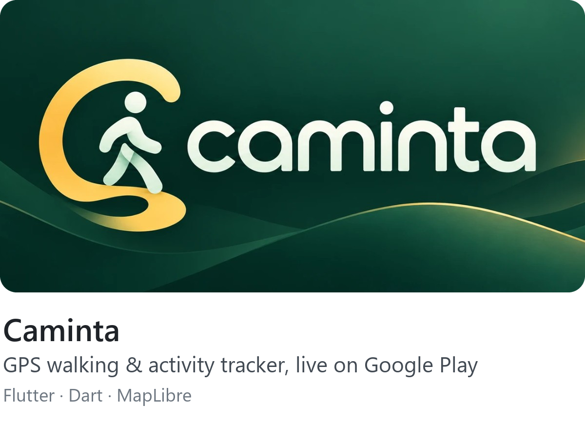
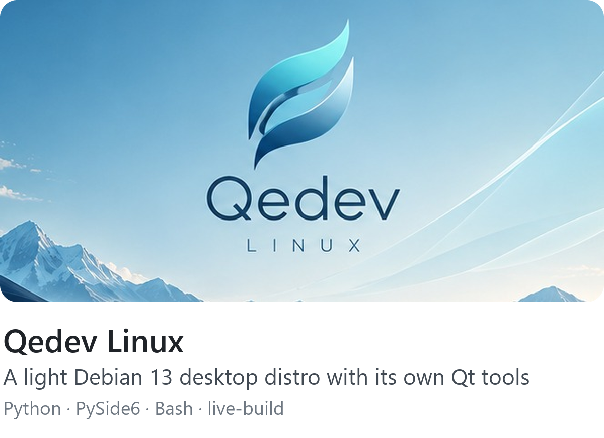
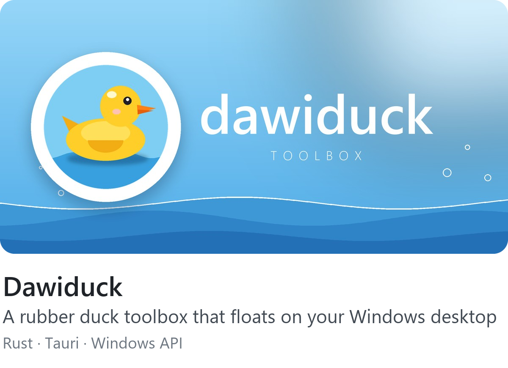

<h1 align="center">ceylanumit</h1>

making small, useful things · apps, linux & data

  <a href="https://www.tosbin.com">tosbin.com</a> &nbsp;·&nbsp;
  <a href="https://github.com/ceylanumit?tab=repositories">all repositories</a> &nbsp;·&nbsp;
  <a href="https://play.google.com/store/apps/details?id=com.tosbin.caminta">caminta on google play</a>

  

### 🕹️ featured projects

  <a href="https://play.google.com/store/apps/details?id=com.tosbin.caminta"><picture><source media="(prefers-color-scheme: dark)" srcset="assets/card-caminta-dark.png"></picture></a>
  &emsp;&emsp;&emsp;
  <a href="https://github.com/ceylanumit/qedev-linux"><picture><source media="(prefers-color-scheme: dark)" srcset="assets/card-qedev-dark.png"></picture></a>

 

  <a href="https://github.com/ceylanumit/menura"><picture><source media="(prefers-color-scheme: dark)" srcset="assets/card-menura-dark.png"></picture></a>
  &emsp;&emsp;&emsp;
  <a href="https://www.tosbin.com/en/#dawiduck"><picture><source media="(prefers-color-scheme: dark)" srcset="assets/card-dawiduck-dark.png"></picture></a>

 

also: <a href="https://github.com/ceylanumit/banknote-authentication">banknote-authentication</a> · <a href="https://github.com/ceylanumit/pc-components-ecommerce">pc-components-ecommerce</a> · <a href="https://github.com/ceylanumit/LavaDo-To-Do-App">LavaDo</a> · <a href="https://github.com/ceylanumit/BiPlayer">BiPlayer</a> · <a href="https://github.com/ceylanumit/Picthrive-PhotoViewer">Picthrive</a> · <a href="https://github.com/ceylanumit/Dimagew">Dimagew</a>

### 🐍 activity

<picture>
  <source media="(prefers-color-scheme: dark)" srcset="https://raw.githubusercontent.com/ceylanumit/ceylanumit/output/github-snake-dark.svg">
  
</picture>

